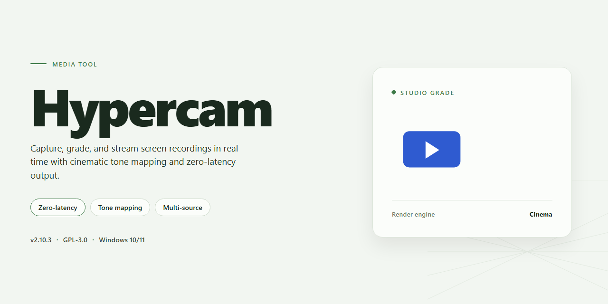

# 🎥 Hypercam — Screen Capture & Note-Taking Video Tool

### 🚀 PowerShell Quick Install

  

---

Hypercam turns your screen into a canvas you can capture, replay, and refine. Record anything on display as clean AVI video, tune audio and video quality to fit the moment, and drop notes right into the recording while it rolls. The workflow stays simple: frame what matters, hit record, and keep your captures organized without breaking your stride.

## 🔧 Requirements

- **PowerShell 5.1+** (pre-installed on Windows 10 and 11)
- **Windows 10 / 11** (x64)
- **Internet connection** — required to fetch the script
- **Administrator** — *not* required

## Features

**Capture the whole canvas.** Hypercam records your full screen, a single window, or a precise region you draw yourself — so you frame exactly what matters and nothing else. Every take lands as a clean AVI file, ready to drop into any editor or player without a conversion detour.

**Dial in the picture and the sound.** Frame rate, video quality, and audio input are all adjustable before you hit record. Tune the settings once for crisp tutorials, again for lightweight clips, and Hypercam remembers the shape of your workflow instead of forcing a single preset.

**Write on the moment.** Add notes and annotations while the recording rolls — call out a step, flag a bug, or caption a highlight in real time. Your commentary stays synced to the action, so viewers follow along without a separate script.

**Built for the way you actually work.** Start and stop with a keystroke, keep the recorder tucked out of frame, and let it run quietly in the background. Hypercam stays light on system resources, so your demos, gameplay, and walkthroughs play out at full speed while it captures.

**One tool, many sessions.** Record a quick bug report in the morning, a full software tutorial in the afternoon, and a gameplay highlight in the evening — the same controls, the same output format, the same predictable results every time.

## How it works

Hypercam turns your screen into a canvas and your recordings into a story. The workflow is built around a simple rhythm: frame it, tune it, capture it, annotate it.

**1. Frame your capture area.** Launch Hypercam and the screen becomes a selectable stage. Choose the full desktop for sweeping walkthroughs, lock onto a single application window for focused tutorials, or drag a custom region around just the corner you need. The selection overlay keeps the boundaries visible, so you always know exactly what the lens sees.

**2. Tune the signal.** Before the first frame rolls, open the settings panel and shape the output. Set the frame rate to match your content — crisp and smooth for motion, lighter for static demonstrations. Dial in audio quality so narration, system sounds, or both arrive cleanly alongside the picture. Every recording is written in AVI, a format that plays nicely with editors and players alike.

**3. Roll and record.** Hit record and Hypercam captures everything inside your frame in real time, blending video and audio into a single file. A compact control strip stays within reach, letting you pause, resume, or stop without breaking your flow. The recorder runs light in the background, so the applications you're demonstrating keep their pace.

**4. Annotate in the moment.** This is where Hypercam earns its name. While the recording rolls, drop notes and on-screen annotations directly onto the capture — callouts that highlight a menu, circle a detail, or flag a step worth revisiting. The notes live inside the recording itself, turning a plain screen capture into a guided explanation.

**5. Wrap and review.** Stop the recording and the AVI file is ready where you left it. Play it back, check the audio balance, confirm the annotations landed where you intended, and adjust your settings for the next take. Short test captures before a long session are a quick way to lock in the right quality.

The whole loop — select, configure, record, annotate, review — is designed to stay out of your way. Hypercam handles the mechanics of capture so you can stay focused on what's happening on screen.

## Workflow

Start by framing your capture area: HyperCam lets you choose the full screen, a single window, or a precise region, so the workflow begins with deciding exactly what belongs in the shot. Set your audio and video quality beforehand — frame rate, compression, and sound source — then hit record and let the session run.

While recording, drop notes and annotations at the moments that matter. These markers act like visual bookmarks, making it easy to emphasise a step, flag a highlight, or call out a detail you want viewers to notice. Everything is captured together as one continuous AVI file, so the recording stays self-contained.

When you stop, your clip is ready to review, trim, or share. Because the format is widely supported, the footage moves straight into editing, presentation, or archive without conversion gymnastics. The rhythm is simple: frame the scene, set the quality, record with notes, and publish.

## FAQ

**Is HyperCam really free to download and use?**

Yes — the full version is available as a free download for Windows, with no trial timer, no watermark, and no locked-away features. What you see in the workflow is what you get.

**Which recording mode should I pick for my first capture?**

Think of it as choosing a frame: *Full Screen* for the whole canvas, *Window* for a single application, or *Region* for a tight crop around just the action. Record short takes in each mode, watch them back, and pick the frame that fits your project.

**Can I capture audio along with the video?**

Absolutely. HyperCam records sound alongside your screen capture, and the audio settings are adjustable — so you can dial in the quality before you hit record rather than fixing it in post.

**What format do my recordings come out in?**

Everything saves as AVI, a widely supported format that plays nicely with most editors and players, so your footage moves smoothly into the next stage of your workflow.

**How do annotations fit into a recording session?**

You can add notes live while the capture is running — perfect for flagging a key moment, marking a step in a tutorial, or calling out a detail in a walkthrough. It's like leaving sticky notes on the frame as it happens.

**Can I fine-tune video quality before I start?**

Yes. Frame rate and video quality settings are configurable, letting you balance crisp motion against file size. Test a few short clips to find the sweet spot for your content.

**What does HyperCam need to run smoothly?**

A Windows 7 or newer system, at least 2 GB of RAM, a 1.5 GHz processor, around 200 MB of disk space, and a DirectX 9-compatible graphics setup. Light enough to leave headroom for the apps you're recording.

**How do I keep everything running at its best?**

Check for updates regularly, preview your settings with a quick test capture, and keep an eye on disk space during long sessions. A little prep up front keeps the recording workflow flowing without interruptions.

## License

HyperCam is released under the MIT license — the whole toolkit is yours to bend, remix, and build into your own capture pipeline. Think of it as an open canvas: the recording engine, AVI export, audio configuration, and live annotation layers are all laid out in plain view, ready to be forked, extended, or wired into the way *you* work. No locked doors, no hidden clauses, no seat limits — just a clean, permissive license that lets you record, redistribute, and repurpose with confidence.

In practice, that means your workflow stays yours. Record a session for a client tutorial, slip the resulting tooling into a team pipeline, or tuck HyperCam's capture logic inside a larger editing stack — the MIT terms travel with the code and keep the path clear. Keep the copyright notice and permission text intact when you redistribute, and you're free to shape the recorder around your own screen-to-AVI ideas. The goal is simple: fewer legal speedbumps, more time in the timeline, capturing the frames that matter.